# Homework: Rooms & Students

**Автор:** Zhyhar Maryia
**Цель отчёта:** зафиксировать ход работы для ментора и Git.

## 1. Задание
- [x] Схема БД (M:1 rooms ← students) — DDL из Python
- [x] Загрузка JSON БД скриптом (SQL, без ORM)
- [x] 4 аналитических запроса (вся математика в SQL)
- [x] Индексы + SQL на их создание
- [x] Выгрузка результата JSON (формат `или` XML — выбран JSON)
- [x] CLI: `--students`, `--rooms`, `--format` (`argparse` в `main.py`)
- [x] OOP + SOLID, без ORM (папка `OOP_code`)

## 2. Данные
| Файл | Сущность | Поля |
|------|----------|------|
| rooms.json | rooms | `id`, `name` |
| students.json | students | `id`, `name`, `birthday`, `sex`, `room` |

Связь: **many-to-one** (много студентов одна комната). 

FK у `students.room` `rooms.id`.

## 3. Схема БД

DDL выполняется из Python-скрипта.

```sql
CREATE TABLE rooms (
    id   INT PRIMARY KEY,
    name VARCHAR(20) NOT NULL
);

CREATE TABLE students (
    id       INT PRIMARY KEY,
    name     VARCHAR(50) NOT NULL,
    birthday DATE,
    sex      CHAR(1) CHECK (sex IN ('M', 'F')),
    room     INT REFERENCES rooms(id)
);
```


## 3.0. Модуль подключения `db.py`

Общее соединение вынесено в отдельный файл (DRY: одна точка настройки БД):

```python
# db.py
import psycopg2

def get_connection():
    return psycopg2.connect(
        dbname='rooms_hw',
        user='admin',
        password='admin123',
        host='localhost',
        port='5432',
    )
```

`load_data.py` и `queries.py` импортируют `from db import get_connection`.

## 3.1. Создание схемы из Python

Скрипт `load_data.py` (фрагмент): `get_connection()` из `db.py` курсор два `CREATE TABLE` `commit`.

```python
import json       # чтение/запись JSON-файлов
import psycopg2   # подключение к PostgreSQL и выполнение SQL из Python

try:
  connection = psycopg2.connect(
      dbname='rooms_hw',
      user='admin',
      password='admin123',
      host='localhost',
      port='5432',
  )
  cursor = connection.cursor()

  cursor.execute("""
    CREATE TABLE rooms (
        id   INT PRIMARY KEY,
        name VARCHAR(20) NOT NULL
    );

    CREATE TABLE students (
        id       INT PRIMARY KEY,
        name     VARCHAR(50) NOT NULL,
        birthday DATE,
        room     INT REFERENCES rooms(id),
        sex      CHAR(1) CHECK (sex IN ('M', 'F'))
    );
  """)
  connection.commit()  # зафиксировать изменения в БД

except Exception as error:
  print('Ошибка при работе с PostgreSQL:', error)

finally:
  if cursor:
    cursor.close()
  if connection:
    connection.close()
```

После выполнения скрипта в БД `rooms_hw` (схема `public`) появились таблицы `rooms` и `students`:

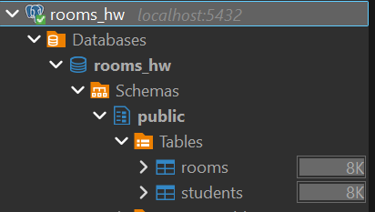


## 3.2. ER-диаграмма (DrawSQL)

Связь many-to-one: `students.room` `rooms.id`.

Диаграмма: [rooms_hw на DrawSQL](https://drawsql.app/teams/mariazhigar/diagrams/rooms-hw)

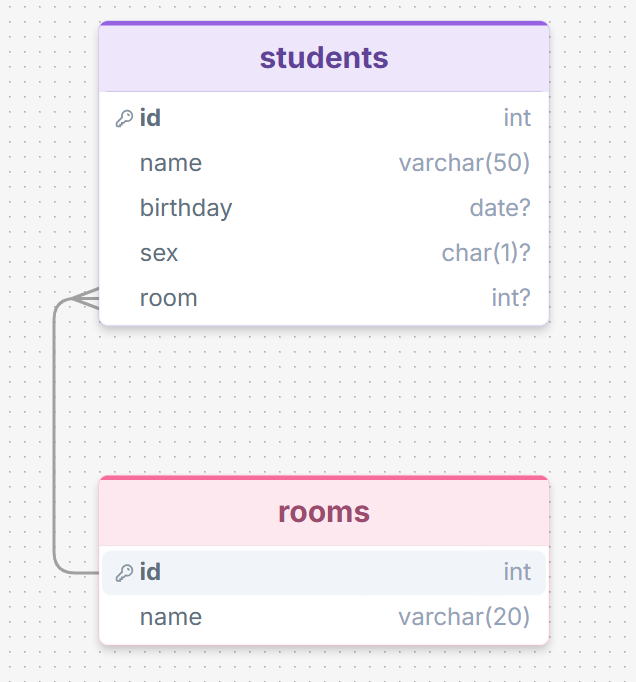

## 4. Загрузка данных

### Библиотеки
| Модуль | Зачем |
|--------|--------|
| `json` | стандартная библиотека Python: читает `rooms.json` / `students.json` в списки словарей |
| `psycopg2` (`psycopg2-binary`) | драйвер PostgreSQL: подключение к БД и выполнение SQL из кода (**без ORM**) |

Установка драйвера: `pip install psycopg2-binary`.

### Шаги скрипта (`load_data.py` / часть CLI)
1. Подключение к Postgres через `psycopg2.connect(...)`.
2. Выполнение DDL (`CREATE TABLE`), если таблиц ещё нет.
3. `json.load` `rooms.json`, затем `INSERT` / `executemany` в `rooms`.
4. `json.load` `students.json`, затем `INSERT` в `students` (у `birthday` — дата без времени).
5. `commit`.

Порядок загрузки: сначала комнаты, потом студенты.


## 4.1. Вставка данных из JSON

После создания таблиц скрипт читает JSON и вставляет строки через `cursor.execute` + `%s`. Сначала `rooms`, потом `students`, после каждого блока — `commit`.

```python
# Чтение JSON-файла rooms.json
with open('rooms.json', 'r', encoding='utf-8') as f:
    rooms = json.load(f)  # Преобразует JSON в список словарей Python

# Вставка данных в базу
# Один круг цикла = одна строка в таблице
for item in rooms:
    cursor.execute(
        '''
            INSERT INTO rooms (id, name)
            VALUES (%s, %s)
        ''',
        # item.get('ключ') - взять из словаря значение по ключу
        (item.get('id'), item.get('name')),
    )
connection.commit()

# Чтение JSON-файла students.json
with open('students.json', 'r', encoding='utf-8') as f:
    students = json.load(f)

for item in students:
    cursor.execute(
        '''
            INSERT INTO students (id, name, birthday, room, sex)
            VALUES (%s, %s, %s, %s, %s)
        ''',
        (item.get('id'), item.get('name'), item.get('birthday'), item.get('room'), item.get('sex')),
    )
connection.commit()
```

После запуска в DBeaver видны данные:

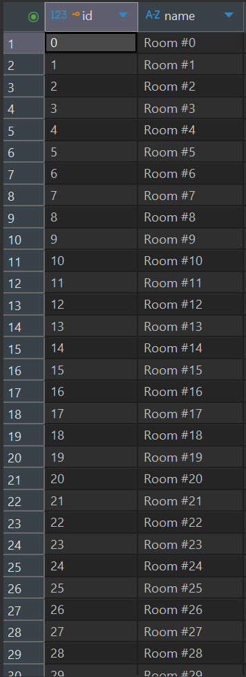

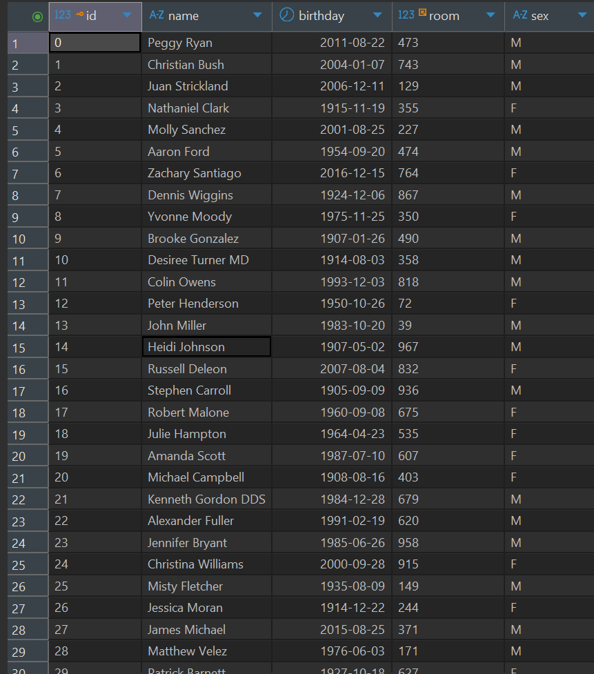


## 5. Архитектура приложения

Два варианта кода:
- `Code/` — процедурный CLI (`main` + функции);
- `OOP_code/` — классы (`Database`, `DataLoader`, `QueryRunner`, `JsonExporter`).
Подробнее про OOP — §10.


## 6. SQL-запросы
1. Список комнат + число студентов ✅  
2. 5 комнат с наименьшим средним возрастом ✅  
3. 5 комнат с наибольшим разбросом возраста ✅  
4. Комнаты, где живут студенты разного пола ✅  

### 6.0. Какой JOIN для запросов 1 и 2

| Запрос | JOIN | Почему |
|--------|------|--------|
| 1. Комнаты + число студентов | `LEFT JOIN` | Нужны **все** комнаты, в том числе пустые (`COUNT = 0`) |
| 2. Топ-5 по среднему возрасту | `INNER JOIN` (или `LEFT` + `HAVING COUNT(s.id) > 0`) | Без студентов среднего возраста нет; пустые комнаты только мешают |

### 6.1. Запрос 1 — комнаты и число студентов

**Идея:** `LEFT JOIN` комнат со студентами по `rooms.id = students.room`, затем `GROUP BY` комнаты и `COUNT(s.id)`. Сортировка по числу студентов по убыванию.

**Почему `LEFT JOIN`, а не `INNER JOIN`:** берём все комнаты слева (`rooms`), даже если в них ещё нет студентов. У пустой комнаты строки студента будут `NULL`, а `COUNT(s.id)` даст `0`. При `INNER JOIN` такие комнаты просто исчезли бы из результата — список был бы неполным.

Скрипт `queries.py` (фрагмент):

```python
from db import get_connection

connection = get_connection()
cursor = connection.cursor()

cursor.execute("""
        SELECT
            r.id,
            r.name,
            COUNT(s.id) AS students_count
        FROM
            rooms AS r
        LEFT JOIN students AS s
            ON r.id = s.room
        GROUP BY
            r.id,
            r.name
        ORDER BY
            students_count DESC;
               """)

# Получить все строки результата запроса (список кортежей)
rows = cursor.fetchall()
# Вывести каждую строку в консоль
for row in rows:
    print(row)
# Закрыть курсор и соединение с БД
cursor.close()
connection.close()
```

Результат в консоли (фрагмент: id, name, students_count), например `(813, 'Room #813', 20)`:

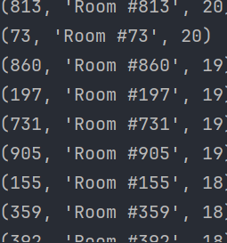

### 6.2. Запрос 2 — 5 комнат с наименьшим средним возрастом

**Идея:** `INNER JOIN` комнат со студентами, возраст из `birthday` через `age` + `EXTRACT(YEAR ...)`, `AVG` по комнате, `ORDER BY average_age ASC`, `LIMIT 5`.

**Почему `INNER JOIN`:** средний возраст без студентов не считается; пустые комнаты здесь не нужны (см. §6.0).

Скрипт `queries.py` (фрагмент):

```python
from db import get_connection

connection = get_connection()
cursor = connection.cursor()

# age(...)             интервал «от дня рождения до сегодня»
# EXTRACT(YEAR FROM …) только целые годы (возраст)
# AVG(...)             среднее по комнате
# ROUND(..., 2)        округление до 2 знаков
# ::float              обычный float вместо numeric/Decimal (для вывода)
cursor.execute("""
        SELECT
            r.id,
            r.name,
            ROUND(AVG(EXTRACT(YEAR FROM age(current_date, s.birthday))), 2)::float AS average_age
        FROM
            rooms AS r
        INNER JOIN students AS s
            ON r.id = s.room
        GROUP BY
            r.id,
            r.name
        ORDER BY
            average_age
        LIMIT 5;
               """)

# Получить все строки результата запроса (список кортежей)
rows = cursor.fetchall()
# Вывести каждую строку в консоль
for row in rows:
    print(row)
# Закрыть курсор и соединение с БД
cursor.close()
connection.close()
```

Результат в консоли (id, name, average_age), например `(661, 'Room #661', 13.0)`:

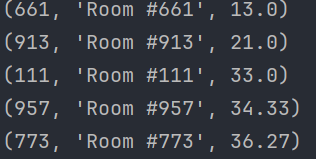

### 6.3. Запрос 3 — 5 комнат с наибольшим разбросом возраста

**Как считаем разброс:** в каждой комнате возраст через `EXTRACT(YEAR FROM age(...))`, затем:

```sql
MAX(возраст) - MIN(возраст)
```

то есть разница между самым старшим и самым младшим. `INNER JOIN`, `GROUP BY` комнаты, `ORDER BY diff_age DESC`, `LIMIT 5`.

**Проверка большого значения (`~115`):** в топе попалась комната с разбросом около 115 лет — это смутило. Написала короткий запрос по `r.id = 712`, чтобы посмотреть реальные `birthday` в одной комнате. В данных есть даты от 1903 до 2019 — разница в возрасте ~115 лет объясняется учебным датасетом, а не ошибкой формулы.

Проверочный запрос:

```python
cursor.execute("""
        SELECT
            r.id,
            r.name,
            s.birthday
        FROM
            rooms AS r
        INNER JOIN students AS s
            ON r.id = s.room
        WHERE
            r.id = 712
               """)
```

Результат (фрагмент дней рождения в Room #712):

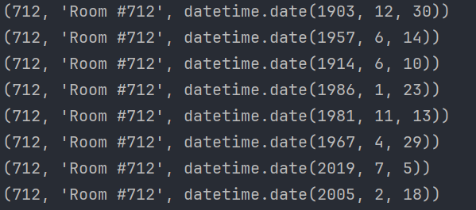

Основной запрос 3:

```python
from db import get_connection

connection = get_connection()
cursor = connection.cursor()

# age(...) / EXTRACT(YEAR ...) возраст в годах
# MAX(...) - MIN(...)         разброс возраста в комнате
# ROUND(...)::float           целое/округлённое число для вывода
cursor.execute("""
        SELECT
            r.id,
            r.name,
            ROUND(MAX(EXTRACT(YEAR FROM age(current_date, s.birthday)))
                - MIN(EXTRACT(YEAR FROM age(current_date, s.birthday))))::float AS diff_age
        FROM
            rooms AS r
        INNER JOIN students AS s
            ON r.id = s.room
        GROUP BY
            r.id,
            r.name
        ORDER BY
            diff_age DESC
        LIMIT 5;
               """)

rows = cursor.fetchall()
for row in rows:
    print(row)
cursor.close()
connection.close()
```

Результат в консоли (id, name, diff_age) — топ-5, у всех `115.0` (учебные даты):

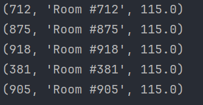

### 6.4. Запрос 4 — комнаты со студентами разного пола

**Идея:** `INNER JOIN` + `GROUP BY` комнаты. В `WHERE` нельзя написать «есть и M, и F» на одной строке. После группировки: `HAVING COUNT(DISTINCT s.sex) = 2` — в комнате ровно два разных значения пола.

Скрипт `queries.py` (фрагмент):

```python
from db import get_connection

connection = get_connection()
cursor = connection.cursor()

# COUNT(DISTINCT s.sex) - количество уникальных полов должно быть равным 2
cursor.execute("""
        SELECT
            r.id,
            r.name
        FROM
            rooms AS r
        INNER JOIN students AS s
            ON r.id = s.room
        GROUP BY
            r.id,
            r.name
        HAVING
            COUNT(DISTINCT s.sex) = 2
               """)

# Получить все строки результата запроса (список кортежей)
rows = cursor.fetchall()
# Вывести каждую строку в консоль
for row in rows:
    print(row)
# Закрыть курсор и соединение с БД
cursor.close()
connection.close()
```

Результат в консоли (фрагмент: id, name):

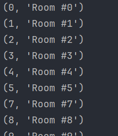


## 7. Индексы

**Зачем:** индекс не меняет результат `SELECT`, а ускоряет поиск строк. Все 4 аналитических запроса джойнят `students` к `rooms` по `students.room` → индекс на эту колонку помогает Postgres быстрее находить студентов комнаты. На небольшом учебном датасете в консоли разницы почти не видно — это нормально.

Отдельный скрипт (не смешивать с аналитическими запросами):

```python
from db import get_connection

connection = get_connection()
cursor = connection.cursor()

cursor.execute("""
        CREATE INDEX IF NOT EXISTS idx_students_room ON students(room);
               """)

connection.commit()

cursor.close()
connection.close()
```


Ожидаем среди прочего `idx_students_room` (плюс индекс PK на `id`).

В DBeaver в ветке Indexes видно `idx_students_room` рядом с PK:

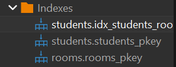


## 8. CLI и форматы вывода

Точка входа — `main.py` (`argparse`). Флаги:

| Флаг | Обязательный | Описание |
|------|--------------|----------|
| `--rooms` | да | путь к `rooms.json` |
| `--students` | да | путь к `students.json` |
| `--format` | нет (по умолчанию `json`) | формат выгрузки; сейчас поддерживается `json` |

Скелет парсера:

```python
import argparse
from pathlib import Path
import json
from load_data import load_data
from db import get_connection

parser = argparse.ArgumentParser()
parser.add_argument("--students", required=True, help="путь к students.json")
parser.add_argument("--rooms", required=True, help="путь к rooms.json")
parser.add_argument("--format", choices=["json"], default="json", help="формат вывода")
args = parser.parse_args()
```

Перед загрузкой таблицы очищаются (`TRUNCATE students, rooms RESTART IDENTITY CASCADE`), чтобы повторный запуск не давал `duplicate key`. Затем вызывается `load_data(args.rooms, args.students)`, выполняются 4 SQL-запроса, результаты пишутся в `results/`.

### 8.1. Выгрузка в JSON

Папка создаётся заранее: `Path("results").mkdir(exist_ok=True)`. После `fetchall` собираем словари и пишем через `json.dump`.

| Запрос | Файл |
|--------|------|
| 1. кол-во студентов по комнатам | `results/rooms_students_count.json` |
| 2. топ-5 по наименьшему среднему возрасту | `results/rooms_avg_age_asc.json` |
| 3. топ-5 по разбросу возраста | `results/rooms_age_diff.json` |
| 4. комнаты с M и F | `results/rooms_mixed_sex.json` |

Пример для запроса 1:

```python
with open("results/rooms_students_count.json", "w", encoding="utf-8") as f:
    data = [{"id": r[0], "name": r[1], "students_count": r[2]} for r in rows]
    # ensure_ascii=False — не экранировать русские буквы
    # indent=2 — красивые отступы
    json.dump(data, f, ensure_ascii=False, indent=2)
```

Аналогично запросы 2–4 (ключи `avg_age` / `age_diff` / только `id`, `name`). XML не делала: в задании формат «или», выбран JSON.

## 9. Как запустить

1. Поднять Postgres (Docker), БД `rooms_hw`, пользователь `admin` / `admin123`, порт `5432`.
2. Установить зависимость: `pip install psycopg2-binary` (или `psycopg2`).
3. Из папки `Code` или `OOP_code` (рядом должны лежать `main.py`, `rooms.json`, `students.json`):

```bash
python main.py --rooms rooms.json --students students.json --format json
```

```bash
C:\Users\maria\AppData\Local\Python\bin\python.exe main.py --rooms rooms.json --students students.json --format json
```

Успешный запуск печатает `готово → папка results/` и обновляет 4 JSON-файла. Без `--rooms` / `--students` `argparse` намеренно выдаёт ошибку о недостающих аргументах.


## 10. OOP и SOLID

Процедурный CLI оставила в `Code/`. OOP-версию собрала отдельно в `OOP_code/`: та же логика, но разнесена по классам (без ORM).

| Класс | Файл | Роль |
|-------|------|------|
| `Database` | `db.py` | подключение, commit, close |
| `DataLoader` | `load_data.py` | TRUNCATE + CREATE + INSERT из JSON |
| `QueryRunner` | `queries.py` | 4 аналитических SELECT |
| `JsonExporter` | `exporter.py` | запись результатов в `results/*.json` |

`main.py` только разбирает argparse и вызывает объекты по цепочке.

Запуск из папки `OOP_code` — те же флаги, что в §9:

```bash
python main.py --rooms rooms.json --students students.json --format json
```

Скрин успешного запуска:

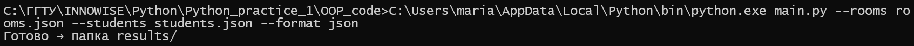
